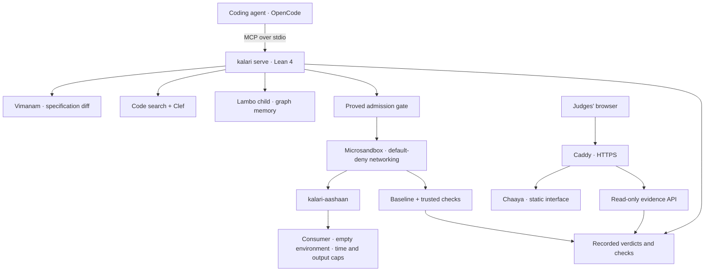

<p align="center">
  
</p>

<h1 align="center">Kalari</h1>

<p align="center"><strong>Give your coding agent a place to prove the migration works.</strong></p>

<p align="center">
  <a href="https://kalari.nryn.dev/">Judges' page</a> ·
  <a href="https://kalari.nryn.dev/docs/">Documentation</a> ·
  <a href="https://github.com/nrynss/kalari/releases/latest">Download</a> ·
  <a href="bench/RESULTS.md">Measured results</a>
</p>

<p align="center">
  <a href="https://github.com/nrynss/kalari/actions/workflows/ci.yml"></a>
  <a href="https://github.com/nrynss/kalari/releases/latest"></a>
  <a href="LICENSE"></a>
</p>

An API changes. Your agent updates the consumer. The program exits successfully. You still need to know whether every record survived.

Kalari gives that agent five MCP tools. They inspect API changes, find affected callers, and verify migrations inside disposable microVMs.

The gate checks each execution request. The aashaan supervises the process. A baseline comparison checks the records. The evidence explains what happened.

Built for **Vultr: Agent Rush**, under the **Blast Radius Zero** challenge.

## See it work

Open the judges' page to inspect runs and their evidence. The containment demonstration shows a cursor loop reaching its time limit.

The command fails with `killed_timeout`. Kalari records the configured limit and measured duration. Boundary and cleanup evidence accompany the run.

| Explore | What you will find |
|---|---|
| [Live judges' page](https://kalari.nryn.dev/) | Run details, checks, logs, and containment evidence |
| [Frozen comparison](bench/RESULTS.md) | Results from 60 runs, with links to every row |
| [Containment transcript](tests/live/containment-transcript.txt) | A deliberate demonstration, separate from benchmark totals |
| [Disbursements showcase](bench/showcase/disbursements/README.md) | A manufactured migration scenario that exposes incorrect record values |

## The developer workflow

Keep your coding agent. Connect Kalari through MCP. Give it the old specification, the new specification, and a consumer to migrate.

1. Preserve the old consumer in a separate baseline workspace.
2. Configure the candidate workspace and the artifact both consumers produce.
3. Set the API destinations and resource limits.
4. Ask the agent to migrate the consumer and verify it through Kalari.
5. Review the changes and run evidence before accepting the migration.

A request can be as simple as this once setup is complete.

> Migrate this payouts consumer to v2. Preserve every record and its values. Use Kalari to inspect the changes and verify the result.

| Tool | What the agent gets |
|---|---|
| `what_changed` | Specification changes and their IDs |
| `blast_radius` | Confirmed and uncertain callers, with a status for every requested ID |
| `recall_lessons` | Applicable advice and required checks from the configured store |
| `run_in_sandbox` | A process verdict, verification checks, and recorded evidence |
| `record_lesson` | A publication attempt tied to verified behavior |

Exploratory commands are allowed. Verification still requires the configured artifact at the workspace root. Missing artifacts return an explanation and `passed=false`.

## Install

The release archive supports **Linux x86-64 with glibc 2.35 or newer**. Binary users do not need Lean.

```sh
mkdir -p kalari-download
cd kalari-download

curl -fLO https://github.com/nrynss/kalari/releases/download/v0.1.3/kalari-0.1.3-linux-x86_64.tar.gz
curl -fLO https://github.com/nrynss/kalari/releases/download/v0.1.3/SHA256SUMS
sha256sum -c SHA256SUMS

tar -xzf kalari-0.1.3-linux-x86_64.tar.gz
mkdir -p "$HOME/.local/bin"
install -m755 kalari-0.1.3-linux-x86_64/bin/kalari "$HOME/.local/bin/kalari"
install -m755 kalari-0.1.3-linux-x86_64/bin/kalari-aashaan "$HOME/.local/bin/kalari-aashaan"
export PATH="$HOME/.local/bin:$PATH"

kalari --version
```

Add that PATH setting to your shell configuration. Releases include configuration examples and a report of linked system libraries.

### Prepare the host

Kalari's demonstrated execution backend uses Microsandbox. It needs accessible KVM on the Linux host that runs Kalari.

| Dependency | Purpose |
|---|---|
| [Microsandbox](https://github.com/superradcompany/microsandbox) 0.7.13 | Create and remove microVMs through `msb` |
| [Vimanam](https://github.com/noemaforge/vimanam) 2.1.0 | Compare API specifications |
| [Lambo](https://github.com/nrynss/lambo) 0.9.0 | Store and recall graph resources |
| `curl`, `rg`, and `getent` | Model requests, code search, and IPv4 resolution |
| Python 3.13 sandbox image | Run the demonstrated Python consumers and checks |

Install those tools using their upstream instructions. Make their executables available through the session's `tool_path`.

```sh
umask 022
test -r /dev/kvm && test -w /dev/kvm
msb doctor
msb pull python:3.13-slim
```

Retry a failed image pull before running migrations. Kalari executes cached images with `--pull never`. It sets guest overcommit for the Lean runtime.

The laptop and Vultr paths both require working virtualization. Other operating systems need a verified execution host and transport setup.

### Configure a migration

Start from the release examples. The repository also carries the deployment configuration and its Lambo settings.

- [Kalari configuration](deploy/vultr/kalari.json.example)
- [Session configuration](deploy/vultr/session.json.example)
- [Lambo configuration](deploy/vultr/lambo.toml.example)

Replace the examples' deployment paths and placeholder baseline command. Create the directories before starting the server.

| Session input | What to supply |
|---|---|
| `workspace` | Absolute path to the candidate code |
| `baseline.workspace` and `baseline.command` | Separate original code and its executable command |
| `old_spec` and `new_spec` | Absolute paths to the API specifications |
| `artifact` | The records filename each consumer writes at its workspace root |
| `check_workspace` | Separate directory for trusted verification code |
| `evidence_workspace` | Writable directory for recorded evidence |
| `aashaan` | Absolute path to the installed supervisor |
| `tool_path` | PATH containing the required host tools |
| `session_id` and `repo_scope` | Identifiers that keep the run and graph resources scoped |

The baseline and candidate must produce comparable JSONL records with string IDs. Kalari checks missing, extra, duplicated, and changed records.

This requires a usable baseline and comparable data. Your consumer must emit the artifact. The benchmark's hidden grader is separate from these runtime checks.

Configure model endpoints and API-key environment names in `kalari.json`. Configure the Lambo child command and its store.

Set the sandbox's maximum caps and allowed API destinations. The baseline has its own limits and destinations within that policy.

Kalari resolves destinations into IP rules. Each microVM denies networking by default. Only the configured destinations become allowed routes.

Keep credentials in the host environment. Never put key values in JSON files or command arguments. The untrusted process starts with an empty environment.

### Connect OpenCode

The recorded setup uses OpenCode 2.2.5. Add this server entry to its MCP configuration, replacing every path with your own absolute path.

```json
{
  "mcp": {
    "servers": {
      "kalari": {
        "type": "local",
        "codemode": false,
        "command": [
          "/absolute/path/to/kalari",
          "serve",
          "/absolute/path/to/kalari.json",
          "/absolute/path/to/session.json"
        ]
      }
    }
  }
}
```

Launch the agent with the required host environment. Confirm it discovers all five tools before starting the migration.

The server speaks MCP over stdio. The public judges' page provides a read-only evidence view. Starting MCP alone does not start that website.

### Deploy on Vultr

The demo uses a Vultr VM with KVM. Vultr Serverless Inference supplies the models. Microsandbox runs the consumers on that VM.

Follow the [Vultr deployment guide](deploy/vultr/README.md) for DNS, credentials, service configuration, and HTTPS setup. The installer builds against the VM's system libraries.

SSH remains on Tailscale. Caddy serves public HTTPS. The deployed read-only API exposes recorded evidence.

## Architecture



The host controls workspaces and policy. The guest executes the consumer. Kalari removes the sandbox after execution.

The deployed API currently uses a Python shim behind Caddy. Its evidence routes mirror the Lean implementation.

Read the [architecture notes](docs/architecture.md) and [measured stack findings](dev-diary/research/README.md) for implementation details and recorded limitations.

## What the evidence supports

The frozen comparison contains 60 runs across six conditions. Every final output passed the hidden grader.

Condition 4 passed its first trusted run in 10 of 10 sessions. Condition 5 did so in 6 of 10 sessions.

Production published zero lessons during these runs. Condition 5 therefore recalled nothing. The comparison provides no measured benefit from learned memory.

Cost and execution measures remain available per condition. Read their attribution limits alongside the results. Token totals use different accounting across arms.

The containment demonstration deliberately triggers a real cursor-loop failure. Its measurements stay separate from the frozen comparison.

[Read the full results and their source rows](bench/RESULTS.md).

### What Lean proves

Four theorems connect the gate's successful decision to workspace, network, cap, and secret predicates. The checked policy governs admission to execution.

The proofs cover those predicates. Runtime sandbox behavior has separate tests and live evidence. Consumer correctness still depends on the verification checks and baseline.

[Inspect the gate and its theorems](Kalari/Gate.lean).

## Build from source

Install elan using Lean's instructions. The repository pins Lean 4.35.0 in `lean-toolchain`. Install ripgrep before building.

```sh
git clone https://github.com/nrynss/kalari.git
cd kalari
lake build kalari kalari-aashaan
./tools/check.sh
```

Executables appear under `.lake/build/bin/`. The gate checks Lean code, supervisor cases, examples, benchmark fixtures, and the web interface.

Live tests stay separate under `tests/live/`. Read each test's requirements before running it.

## The name and the mark

A kalari is a training arena for kalaripayattu, Kerala's martial art. The aashaan is its teacher.

Our mark places a coiled urumi inside a stepped pit. The staff pins the loop. Four corner studs represent the gate's four proved properties.

[Explore the visual identity](dev-diary/design/README.md).

## License and dependencies

Kalari uses the [MIT license](LICENSE). Vimanam uses Apache-2.0. Microsandbox uses Apache-2.0. Lambo uses Apache-2.0. The benchmark's graphql-core dependency uses MIT.

Check each upstream project for its license and distribution terms.

[Lean](https://github.com/leanprover/lean4) · [Vimanam](https://github.com/noemaforge/vimanam) · [Lambo](https://github.com/nrynss/lambo) · [Microsandbox](https://github.com/superradcompany/microsandbox) · [graphql-core](https://github.com/graphql-python/graphql-core)
